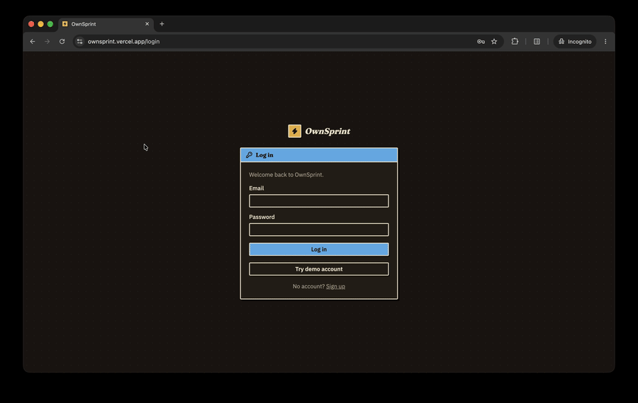
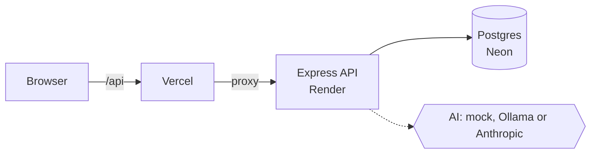

# OwnSprint

[](https://github.com/legendfinka/ownsprint/actions/workflows/ci.yml)

A small Jira-style sprint tracker with AI help. Plan sprints, drag tasks across a Kanban board, and let AI break tasks down, estimate them and summarise a sprint.

**Live demo:** https://ownsprint.vercel.app (click **Try demo account**). The free server sleeps when idle, so the first load can take a minute.



## What it does

- Register, log in, edit your profile and avatar.
- Projects with owner and member roles.
- Sprints: start one, complete it, and choose where unfinished tasks go.
- Kanban board with drag and drop (mouse, keyboard, touch).
- Tasks with subtasks, priority, story points and assignees.
- Search and filters with pagination.
- AI: break a task into subtasks, suggest estimates, stream a sprint summary. You review every suggestion before it is saved.

## How it works



Vercel serves the app and proxies `/api` to the API, so everything is one origin: no CORS, and a strict cookie. The API is layered (`routes → controller → service → repository`) and shares Zod schemas with the web app (`packages/shared`).

## Key decisions

- **One set of Zod schemas** for web and API, so forms show the same errors the server returns.
- **Authorization in services.** Every call checks project membership; ids from the client are never trusted.
- **Rotating refresh tokens** stored hashed. Reusing an old one logs the user out everywhere. The access token lives only in memory.
- **Fractional positions** for drag and drop: a move updates one row.
- **Completing a sprint is one transaction**, so two simultaneous requests can't both win.
- **AI output is validated** with Zod, and nothing is saved without confirmation. Providers are swappable; tests use the mock.
- **Optimistic updates** with rollback, and the URL holds the open task, filters and sprint.
- **Private demo per visitor:** a throwaway account with its own sample project, deleted after 24 hours.

## Run it locally

You need Node 24, pnpm and Docker.

```bash
pnpm install
cp apps/api/.env.example apps/api/.env
docker compose up -d
pnpm --filter api db:migrate
pnpm --filter api seed      # optional: demo@ownsprint.dev / demo-password-123
pnpm dev                    # web :5173, api :4000
```

Checks: `pnpm lint`, `pnpm typecheck`, `pnpm test`. CI runs them, plus a format check, on every push.

`AI_PROVIDER` in `apps/api/.env` picks `mock` (default), `ollama` (local) or `anthropic` (needs a key). The live demo uses the mock.

## Deployment

Free tiers: Vercel (web), Render (API, see `render.yaml`), Neon (database). `apps/web/vercel.json` proxies `/api` to Render.

## Limitations

- No email verification or password reset (no emails are sent).
- Free-tier cold starts.
- The live demo uses mock AI answers.
- "One active sprint" is checked in code, not by a database constraint.
